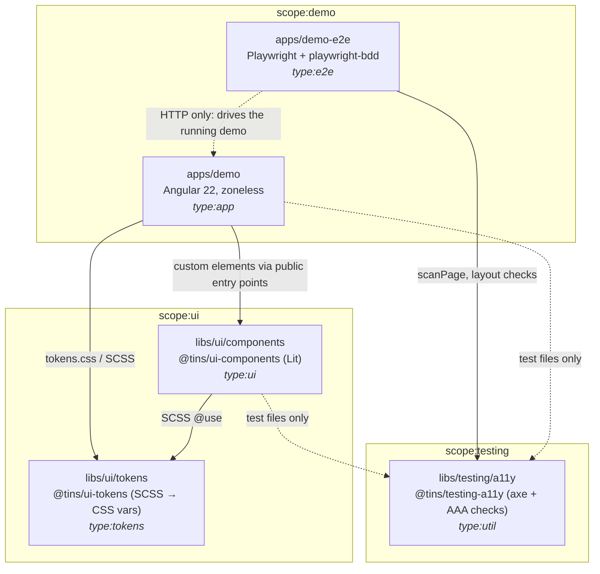
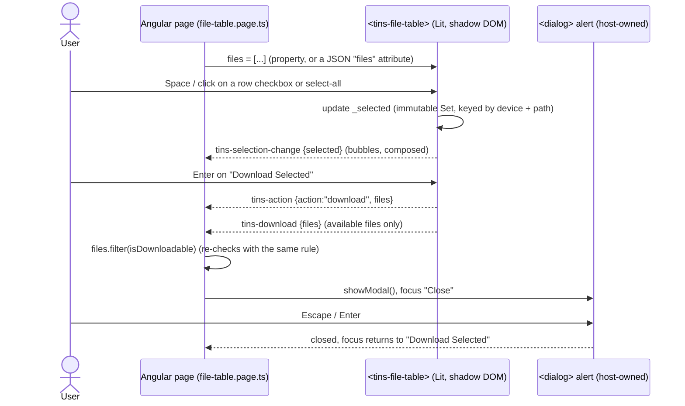

# Architecture, non-functional requirements and how they are tested

This document gives an overview of the system: how it is put together, which non-functional
requirements (NFRs) it has to meet, and which tool or framework checks each one. The accessibility
policy and test layers are detailed in [ACCESSIBILITY.md](ACCESSIBILITY.md). The normative
requirements are in [`openspec/specs/`](openspec/specs/).

---

## 1. What the system is

A **framework-agnostic web component library** (`tins-*` custom elements written in Lit), a
**design-token library** that themes it, and an **Angular demo app** that hosts the components the
way a real consumer would. The main component is `<tins-file-table>`. It lists files, lets the user
select the **available** ones (per-row checkboxes, tri-state select-all, live "Selected N" count),
and emits a `tins-download` event. **The host app does the actual download.**

## 2. Architecture

### 2.1 Projects and dependency direction

Nx 24 monorepo, npm, one root `package.json`. All `@nx/*` packages share the `nx` version
(checked by `npm run verify`).

| Path                 | Project         | Tags                         | What it is                                                                                             |
| -------------------- | --------------- | ---------------------------- | ------------------------------------------------------------------------------------------------------ |
| `apps/demo`          | `demo`          | `type:app`, `scope:demo`     | Angular demo (standalone, zoneless), built/served/tested with Vite via `@analogjs/vite-plugin-angular` |
| `apps/demo-e2e`      | `demo-e2e`      | `type:e2e`, `scope:demo`     | Playwright suite for the demo, written as Gherkin features (playwright-bdd); see §2.4 and §4.4         |
| `libs/ui/components` | `ui-components` | `type:ui`, `scope:ui`        | Lit web components, `@tins/ui-components` (+ `/button`, `/file-table`)                                 |
| `libs/ui/tokens`     | `ui-tokens`     | `type:tokens`, `scope:ui`    | Design tokens: SCSS → CSS custom properties, `@tins/ui-tokens`                                         |
| `libs/testing/a11y`  | `testing-a11y`  | `type:util`, `scope:testing` | Shared axe config and WCAG 2.2 AAA checks for Vitest and Playwright, `@tins/testing-a11y`              |
| `tools/`             | –               | –                            | Repo checks (`tools/scripts`) and local ESLint rules (`tools/eslint`)                                  |



| Rule                                                                              | Why                                                        | Enforced by                                                       |
| --------------------------------------------------------------------------------- | ---------------------------------------------------------- | ----------------------------------------------------------------- |
| Components never import `@angular/*`, `rxjs`, `zone.js`, `react`, `vue`, `svelte` | Components must work in any framework, or in none          | `@nx/enforce-module-boundaries` (`bannedExternalImports`)         |
| Dependencies only point "down": app → ui → tokens → util                          | No cycles, and libraries never know about apps             | `@nx/enforce-module-boundaries` (tags `type:*`, `scope:*`)        |
| `@tins/testing-a11y` may be imported only from tests and e2e                      | Test code (axe-core) must never ship in production bundles | Scope rule + `testFileRules`                                      |
| Consumers import only the subpaths listed in a library's `package.json` `exports` | The public API stays explicit and versionable              | `no-restricted-imports` (`tools/eslint/public-entry-points.mjs`)  |
| Every project has a `type:` and a `scope:` tag                                    | Untagged projects would get around the rules above         | `tins/require-project-tags` (`tools/eslint/plugin.mjs`)           |
| The rules themselves keep working                                                 | A config change must not quietly turn a ban into a no-op   | `tools/scripts/check-boundaries.mjs` (in `npm run verify` and CI) |

#### Dependency rules in detail

Enforced in the root `eslint.config.mjs`.

**By type** (`@nx/enforce-module-boundaries`):

| Source                     | May import                                                                                  |
| -------------------------- | ------------------------------------------------------------------------------------------- |
| `type:app`                 | `type:ui`, `type:tokens`, `type:util`                                                       |
| `type:e2e`                 | `type:util` (reads the demo's `routes.manifest.json` from disk, not via import)             |
| `type:ui`                  | `type:tokens`, `type:util`. Never `@angular/*`, `rxjs`, `zone.js`, `react`, `vue`, `svelte` |
| `type:tokens`, `type:util` | `type:util`                                                                                 |

**By scope** (checked per import, not transitively): `scope:ui` → `scope:ui`;
`scope:demo` → `scope:ui`, `scope:demo`. `scope:testing` (`@tins/testing-a11y`) may be imported
only from test files (`*.spec.ts`, `*.test.ts`, test setup) and from e2e projects, whose
`eslint.config.mjs` applies the exported `testFileRules` to every file.

**Public entry points only:** `no-restricted-imports` allows `@tins/<lib>/<subpath>` only for
subpaths listed in that library's `package.json` `exports` (`tools/eslint/public-entry-points.mjs`).
Relative imports into another project are rejected by the Nx rule.

**Tags required:** every project needs a `type:` and a `scope:` tag (`tins/require-project-tags` in
`tools/eslint/plugin.mjs`); untagged projects fail lint.

#### Boundary regression check

`tools/scripts/check-boundaries.mjs` runs as part of `npm run verify` (`nx run workspace:verify`)
and in CI. It lints in-memory snippets with each project's real ESLint config and fails if any of
these is **not** rejected:

| Case                                                     | Rejected by                                                          |
| -------------------------------------------------------- | -------------------------------------------------------------------- |
| `libs/ui/components` imports `apps/demo`                 | `@nx/enforce-module-boundaries` (relative import of another project) |
| `libs/ui/components` imports `@angular/core`             | `@nx/enforce-module-boundaries` (`bannedExternalImports`)            |
| `libs/ui/tokens` imports `@tins/ui-components/button`    | `@nx/enforce-module-boundaries` (dependency cycle / direction)       |
| `apps/demo` imports `@tins/ui-components/shared/define`  | `no-restricted-imports` (not a public entry point)                   |
| `apps/demo` production code imports `@tins/testing-a11y` | `@nx/enforce-module-boundaries` (scope)                              |

It also checks that a public entry-point import from the demo **passes**, so the rules cannot
become blanket bans unnoticed.

Recorded 2026-11-01: all cases behave as expected (also confirmed once with real temporary files
under `libs/ui/components/src` and `apps/demo/src/app`, which were then removed).

### 2.2 Runtime view: the file table inside the demo



Design decisions shown here:

- **Data in, events out.** The component owns _selection state_ only. It never fetches, downloads
  or routes. Hosts pass data through properties (or a JSON attribute, for plain HTML) and listen to
  DOM `CustomEvent`s that bubble and are `composed`, so they cross shadow roots.
- **One availability rule, shared.** `isDownloadable()` (trimmed, case-insensitive `available`) is
  exported, so the host re-applies the exact rule the component used (defence in depth).
- **Theming through CSS custom properties.** `--tins-*` tokens from `@tins/ui-tokens` cross the
  shadow boundary. `::part()` hooks (`row`, `row-selected`, `toolbar`, …) give styling escape
  hatches without opening up the internals.
- **Safe registration.** `define()` registers a tag once, so loading the library twice does not
  throw `NotSupportedError`.

### 2.3 Build and delivery

| Artifact                  | Built by                                                | Notes                                                                                                                       |
| ------------------------- | ------------------------------------------------------- | --------------------------------------------------------------------------------------------------------------------------- |
| `dist/libs/ui/components` | Vite library mode, `vite-plugin-dts`, CEM analyzer      | ESM only, one entry per component (`/button`, `/file-table`), Lit and tokens kept external, `.d.ts`, `custom-elements.json` |
| `dist/libs/ui/tokens`     | Sass                                                    | `tokens.css` plus the SCSS sources                                                                                          |
| `dist/apps/demo`          | Vite + `@analogjs/vite-plugin-angular`                  | Standard SPA build, `es2022`                                                                                                |
| `dist/apps/demo-gh-pages` | `vite build --mode gh-pages` + `vite-plugin-singlefile` | One self-contained `index.html` with hash routing. Works on GitHub Pages or straight from disk                              |

Targets are inferred by the Nx plugins in `nx.json` from `vite.config.mts`, `playwright.config.mts`
and `eslint.config.mjs`; `build`, `test`, `lint` and `e2e` are cached.

### 2.4 End-to-end suite (`apps/demo-e2e`)

| Path                 | What it is                                                                                      |
| -------------------- | ----------------------------------------------------------------------------------------------- |
| `features/*.feature` | The tests: Gherkin scenarios (smoke, accessibility, route coverage, keyboard, presentation)     |
| `steps/fixtures.ts`  | `createBdd(test)` and the `demo` / `world` fixtures; exports `Given`, `When`, `Then`            |
| `steps/*.steps.ts`   | Step definitions grouped by domain (navigation, keyboard, components, accessibility, layout, …) |
| `src/support/`       | Helpers the steps use (`page.ts`, `routes.ts`, `per-route-examples.ts`)                         |
| `.features-gen/`     | Generated Playwright tests (git-, ESLint- and Prettier-ignored)                                 |

`playwright.config.mts` calls `defineBddConfig` (`missingSteps: 'fail-on-gen'`); its result is the
Playwright `testDir`. The `bddgen` target (`npx bddgen -c playwright.config.mts`, cached; inputs are
the features, steps, support helpers, config and `routes.manifest.json`) generates the tests, and
`e2e` depends on it (`dependsOn: ["^build", "bddgen"]`). An undefined or ambiguous step fails
`bddgen`, before any browser starts. Scenarios tagged `@chromium-only` are excluded from the WebKit
project with `grepInvert`. The inferred atomized `e2e-ci--*` targets are derived from
files in `testDir`, which only exist after generation, so they are not supported for this project;
CI runs `e2e`. A code-only `*.spec.ts` under `src/` or `steps/` fails lint, because it would never
run. How to add a scenario: `apps/demo-e2e/README.md`.

---

## 3. Framework and tool choices

| Concern                | Choice                                              | Why this and not the usual alternative                                                                                                                                                                                                                |
| ---------------------- | --------------------------------------------------- | ----------------------------------------------------------------------------------------------------------------------------------------------------------------------------------------------------------------------------------------------------- |
| Monorepo / task runner | **Nx 24** (npm)                                     | Project graph, tag-based boundary lint, cached `build`/`test`/`lint`/`e2e`, and `nx affected` so CI runs only what changed. Targets are inferred from tool configs, not hand-written.                                                                 |
| Components             | **Lit 3** web components                            | Native custom elements work in Angular, React, Vue or plain HTML. Lit adds reactive properties and auto-escaping templates in about 5 KB. A framework-specific library would tie consumers to one stack.                                              |
| Demo host              | **Angular 22** (standalone, zoneless, signals)      | Shows that the components work inside a large framework with `CUSTOM_ELEMENTS_SCHEMA`. If they work there, simpler hosts are covered too.                                                                                                             |
| Build                  | **Vite 8** (+ Analog plugin for Angular)            | One build tool for libraries, app and tests. The Analog plugin lets Angular run through Vite instead of a separate builder.                                                                                                                           |
| Styles                 | **SCSS** compiled to **CSS custom properties**      | SCSS for authoring (mixins, functions). Custom properties at runtime, because they are the only styling channel that crosses shadow DOM, and they allow switching themes without a rebuild.                                                           |
| Unit tests             | **Vitest 5 in browser mode** (Playwright Chromium)  | Accessibility, contrast, focus rings and layout need a real rendering engine. jsdom has no layout, so axe colour-contrast and size checks would be meaningless there. Vitest shares the Vite config, so no second build pipeline.                     |
| E2E tests              | **Playwright** + **playwright-bdd** (Gherkin)       | One API for several engines, built-in emulation (viewport, `prefers-reduced-motion`, `forced-colors`), traces on retry. Gherkin keeps scenarios readable for non-developers. Undefined steps fail at generation time (`missingSteps: 'fail-on-gen'`). |
| Accessibility engine   | **axe-core** (`@axe-core/playwright` in e2e)        | Industry-standard rule engine with WCAG tags. Wrapped once in `@tins/testing-a11y`, so unit and e2e tests use **the same rule set**, including the AAA rules axe turns off by default.                                                                |
| Static analysis        | **ESLint 9** flat config, **TypeScript 6** `strict` | `eslint-plugin-lit`, `eslint-plugin-lit-a11y`, `@angular-eslint/template` a11y rules, `eslint-plugin-playwright`, plus local rules for boundaries and tags.                                                                                           |
| API documentation      | **Custom Elements Manifest** analyzer               | Generates `custom-elements.json` from JSDoc (`@fires`, `@csspart`, `@cssprop`). IDEs and tooling read it, and a test checks the README against it.                                                                                                    |
| Coverage               | **Istanbul** via `@vitest/coverage-istanbul`        | Works in Vitest browser mode, where V8 coverage does not apply.                                                                                                                                                                                       |
| Requirements           | **OpenSpec**                                        | Requirements and scenarios live in `openspec/specs/*`. Each change is proposed, implemented and archived (`openspec/changes/archive/`), so every behaviour can be traced back to a spec.                                                              |
| CI                     | **GitHub Actions**                                  | One job: verify → A11Y.md check → `nx affected -t lint test build e2e`. The Playwright report (with the axe results) and coverage are uploaded as artifacts.                                                                                          |

---

## 4. Non-functional requirements and how each one is tested

Each NFR below gives the target, the mechanism that verifies it, and where that mechanism lives.
"Gate" means a failure blocks the merge in CI.

### 4.1 Accessibility: WCAG 2.2 A, AA **and AAA**

The most demanding NFR. It is checked in **three automated layers** plus a **manual review
record**, because automated tools can confirm only part of AAA.

| Layer     | Framework                                             | What it proves                                                                                                                                                                                                                                                      | Gate                                                                                              |
| --------- | ----------------------------------------------------- | ------------------------------------------------------------------------------------------------------------------------------------------------------------------------------------------------------------------------------------------------------------------- | ------------------------------------------------------------------------------------------------- |
| 1. Static | ESLint (`lit-a11y`, `@angular-eslint/template`)       | Templates have no obvious a11y faults (e.g. `` without `alt`). Lint also blocks `disableRules` and `{ enabled: false }` in axe options.                                                                                                                        | ✅                                                                                                |
| 2. Unit   | Vitest browser mode + axe-core + `@tins/testing-a11y` | axe with the AAA rule set on **every documented state** of every component, `assertTargetSize` (≥ 44×44 px, 2.5.5), `assertFocusVisible` (≥ 2 px, ≥ 3:1, not hidden: 2.4.11–2.4.13), token contrast for every theme (text ≥ 7:1, UI and focus ≥ 3:1: 1.4.6, 1.4.11) | ✅                                                                                                |
| 3. E2E    | Playwright + playwright-bdd + `@axe-core/playwright`  | axe on **every route × every theme**, keyboard-only flows, skip link, reflow at 320 px (1.4.10), text spacing (1.4.12), 200 % zoom and text size (1.4.4), reduced motion (2.3.3), forced colours (Chromium)                                                         | ✅                                                                                                |
| 4. Manual | `A11Y.md` next to each component + PR checklist       | Screen readers (NVDA + Firefox, VoiceOver + Safari), 2.4.9, 2.4.10, 3.1.3, 3.1.5, 3.1.6, Windows High Contrast                                                                                                                                                      | ✅ (`check-a11y-review.mjs` fails if a component's source changes without its `A11Y.md` changing) |

Guardrails that keep the layers honest:

- **No silent suppression.** The only way to exclude an axe rule is
  `excludeRule({ rule, selector, reason, issue })`. It needs a specific selector, a reason of at
  least 15 characters and a tracking issue.
- **No untested route.** `route-coverage.feature` fails when a route in `routes.manifest.json` has
  no row in a `@per-route` outline (per theme for the scans), or when an outline lists a route that
  does not exist.
- **Evidence.** Each e2e scan attaches its full axe result (`axe:<path>:<theme>`) to the Playwright
  HTML report, which CI keeps for 14 days.

### 4.2 Functional correctness and robustness of the component

| Requirement                                                                                   | How it is tested                                                                                                                                                              |
| --------------------------------------------------------------------------------------------- | ----------------------------------------------------------------------------------------------------------------------------------------------------------------------------- |
| Only `available` files can be selected or downloaded, whatever the casing or whitespace       | `file-table.spec.ts` › _selection_, _isDownloadable_ (variants like `" AVAILABLE "` accepted, look-alikes rejected); e2e _Files that are not available cannot be chosen_      |
| Select-all is a correct tri-state (unchecked / mixed / checked) after any sequence of actions | About 40 unit cases, grouped by OpenSpec requirement (click, Space, row click, data changes that add, remove or change rows); 9 e2e scenarios with mouse and keyboard         |
| Bad input never crashes rendering                                                             | Unit tests for missing `files`, non-string or empty statuses, statuses made only of separators, non-scalar cell values; `isDownloadable` _never throws for malformed entries_ |
| Selection survives data refreshes correctly                                                   | Unit: equal entries keep the selection; removed files or files that became unavailable are dropped without a spurious event                                                   |
| The host acts only on valid data                                                              | The demo re-filters with `isDownloadable` before opening the alert; e2e checks the alert lists exactly the expected device and path pairs                                     |

Framework: **Vitest** (browser mode) for exhaustive state combinations, which are fast and cheap;
**Playwright** for the user journeys that cross the component–host boundary.

### 4.3 Interoperability / framework independence

| Requirement                                                                                               | How it is tested                                                                                                                                                                                                                                                                                                                                                                                                                                                                                                                                                | Gate |
| --------------------------------------------------------------------------------------------------------- | --------------------------------------------------------------------------------------------------------------------------------------------------------------------------------------------------------------------------------------------------------------------------------------------------------------------------------------------------------------------------------------------------------------------------------------------------------------------------------------------------------------------------------------------------------------- | ---- |
| Components contain no framework code                                                                      | `bannedExternalImports` lint, plus a regression case in `check-boundaries.mjs`                                                                                                                                                                                                                                                                                                                                                                                                                                                                                  | ✅   |
| Works inside Angular                                                                                      | Demo unit tests (`app.spec.ts`, `pages.spec.ts`) and the whole e2e suite run against the Angular host                                                                                                                                                                                                                                                                                                                                                                                                                                                           | ✅   |
| Data can be set declaratively                                                                             | Unit: _accepts files as a JSON attribute (plain HTML, no script)_                                                                                                                                                                                                                                                                                                                                                                                                                                                                                               | ✅   |

### 4.4 Cross-browser compatibility

| Engine   | Coverage                                                                                                                                                          |
| -------- | ----------------------------------------------------------------------------------------------------------------------------------------------------------------- |
| Chromium | Unit tests (Vitest browser mode) and the full e2e suite, including `@chromium-only` scenarios (forced colours, dark and high-contrast scans, arrow-key scrolling) |
| WebKit   | Full e2e suite minus `@chromium-only` (`grepInvert`). In WebKit, "Tab" means Option+Tab, as in Safari.

### 4.5 Responsiveness / adaptable layout

Tested in **Playwright** (`presentation.feature`, `file-table.feature`) with shared helpers from
`@tins/testing-a11y/playwright`:

- `assertNoReflowOverflow(page, 320)`: no horizontal page scroll and no clipped text at 320 CSS px.
- 640×400 viewport = a 1280 px window at 200 % zoom → `findLayoutProblems` returns nothing.
- At 320 px the table sits in a **labelled, focusable scroll region** that keyboard users can reach
  and scroll with the arrow keys, and every path in the download alert is fully visible.

### 4.6 Theming and visual consistency

| Requirement                                                       | Test                                                                                                            |
| ----------------------------------------------------------------- | --------------------------------------------------------------------------------------------------------------- |
| Three themes (`light`, `dark`, `high-contrast`), all AAA contrast | `libs/ui/tokens/src/lib/contrast.spec.ts` checks every declared token pair in every theme (`contrast-pairs.ts`) |
| The CSS output matches the token definitions                      | `css-output.spec.ts`, `mixins.spec.ts`                                                                          |
| Hover, selected and selected-hover rows look different            | Unit tests and the e2e _Rows change colour on hover and when chosen_ scenario (compares computed colours)       |
| The theme menu offers exactly the themes that are scanned         | e2e _The theme menu offers exactly the scanned themes_                                                          |

### 4.7 Maintainability and modularity

| Requirement                      | Mechanism                                                                                                                                  | Gate |
| -------------------------------- | ------------------------------------------------------------------------------------------------------------------------------------------ | ---- |
| Enforced architecture (§2.1)     | ESLint boundary rules + `check-boundaries.mjs` regression suite                                                                            | ✅   |
| Type safety                      | TypeScript `strict`; `typecheck` target runs `tsc --noEmit` for library and spec configs                                                   | ✅   |
| Consistent toolchain versions    | `check-nx-versions.mjs`: every `@nx/*` matches `nx`                                                                                        | ✅   |
| Every component ships with tests | `coverage.spec.ts` fails if `src/<component>/` has no `*.spec.ts`                                                                          | ✅   |
| Code coverage                    | Istanbul thresholds of **90 %** statements, branches, functions and lines for `ui-components` (coverage is on for its `test` target)       | ✅   |
| Traceability                     | Unit `describe` blocks and Gherkin scenarios are named after OpenSpec requirements; changes are archived under `openspec/changes/archive/` | –    |

### 4.8 Documented, stable public API

| Requirement                                                                   | Test                                                                                                                                              |
| ----------------------------------------------------------------------------- | ------------------------------------------------------------------------------------------------------------------------------------------------- |
| Every attribute, member, event, slot, CSS part and CSS property is documented | `readme.node.spec.ts` reads `custom-elements.json` and fails if any item is missing from that element's section of `libs/ui/components/README.md` |
| Only declared entry points are importable                                     | `exports` map in `package.json` + `no-restricted-imports` lint                                                                                    |
| Types ship with the package                                                   | `vite-plugin-dts` generates `.d.ts`; test helpers (`src/testing/**`) are excluded from the published types                                        |

### 4.9 Security

| Concern                               | How it is handled                                                                                                                                                                  | Test status                                                                                                |
| ------------------------------------- | ---------------------------------------------------------------------------------------------------------------------------------------------------------------------------------- | ---------------------------------------------------------------------------------------------------------- |
| Injection through file names or paths | All data goes through Lit `html` templates, which auto-escape. Production code has no `unsafeHTML` or `innerHTML` (only test fixtures use them). Non-scalar values render as `''`. | Relies on Lit's guarantee. **No explicit XSS test** (e.g. a file name of ``). Worth adding. |
| Acting on invalid selections          | The component filters to available files; the host re-checks with the exported `isDownloadable()`                                                                                  | Unit and e2e (§4.2)                                                                                        |
| Test code reaching production         | `scope:testing` import restriction                                                                                                                                                 | Lint + boundary regression                                                                                 |
| CI supply chain                       | `npm ci` from the lockfile; workflow `permissions: contents: read`                                                                                                                 | –                                                                                                          |

### 4.10 Performance and footprint

| Concern                      | Current mechanism                                                                                                       | Test status                                                                     |
| ---------------------------- | ----------------------------------------------------------------------------------------------------------------------- | ------------------------------------------------------------------------------- |
| Small bundles for consumers  | One entry per component (import only what you use); Lit and tokens marked `external` so consumers dedupe them; ESM only | `reportCompressedSize` prints gzip sizes on build. **No size budget enforced.** |
| Efficient re-rendering       | Selection is an immutable `Set` replaced on change, so Lit can rely on identity checks                                  | Not benchmarked                                                                 |
| Fast feedback in development | Nx caching + `nx affected`; Vite dev server                                                                             | –                                                                               |

There are **no automated performance tests** today: no bundle-size budget, no render benchmark for
large file lists, no Lighthouse or Web Vitals run. If performance becomes a requirement, the
natural next steps are a `size-limit` check on `dist/libs/ui/components`, and a Vitest browser
benchmark that renders and select-alls 1,000+ rows.

### 4.11 Reliability of the test suite itself

- **Real browsers everywhere** (no jsdom for UI), so tests do not pass because of fake layout.
- **Production build in CI:** e2e runs against `vite preview` of the production build, not the dev
  server.
- **Fail fast on drift:** `bddgen` fails on undefined or ambiguous steps before any browser starts;
  `forbidOnly` in CI; a code-only `*.spec.ts` in the e2e project fails lint, because it would never run.
- **Controlled flakiness:** one retry in CI, with a trace recorded on the first retry for diagnosis.

---

## 5. NFR → test traceability at a glance

| NFR                                 | Lint | Unit (Vitest browser) | E2E (Playwright) | Repo scripts                            |           Manual            |
| ----------------------------------- | :--: | :-------------------: | :--------------: | --------------------------------------- | :-------------------------: |
| Accessibility (WCAG 2.2 AAA)        |  ✅  |          ✅           |        ✅        | `check-a11y-review.mjs`                 |        ✅ `A11Y.md`         |
| Functional correctness / robustness |      |          ✅           |        ✅        |                                         |                             |
| Framework independence              |  ✅  |    ✅ (plain HTML)    |   ✅ (Angular)   | `check-boundaries.mjs`                  |                             |
| Cross-browser                       |      |       Chromium        | Chromium, WebKit |                                         | NVDA + Firefox, VO + Safari |
| Responsive / adaptable layout       |      |                       |        ✅        |                                         |                             |
| Theming and contrast                |      |          ✅           |        ✅        |                                         |                             |
| Maintainability / modularity        |  ✅  | ✅ (coverage ≥ 90 %)  |                  | `check-boundaries`, `check-nx-versions` |                             |
| Documented public API               |  ✅  |  ✅ (README ↔ CEM)   |                  |                                         |                             |
| Security                            |  ✅  |        partial        |     partial      |                                         |                             |
| Performance                         |      |           –           |        –         |                                         |                             |

## 6. Running the checks

```sh
npm ci && npx playwright install --with-deps
npm run verify                         # Nx version policy + boundary regression suite
npx nx run-many -t lint test build     # static + unit layers (coverage for ui-components)
npx nx e2e demo-e2e                    # Gherkin e2e: a11y scans, keyboard, presentation, file table
node tools/scripts/check-a11y-review.mjs   # manual-review record check against main
npx nx affected -t lint test build e2e # what CI runs
```
